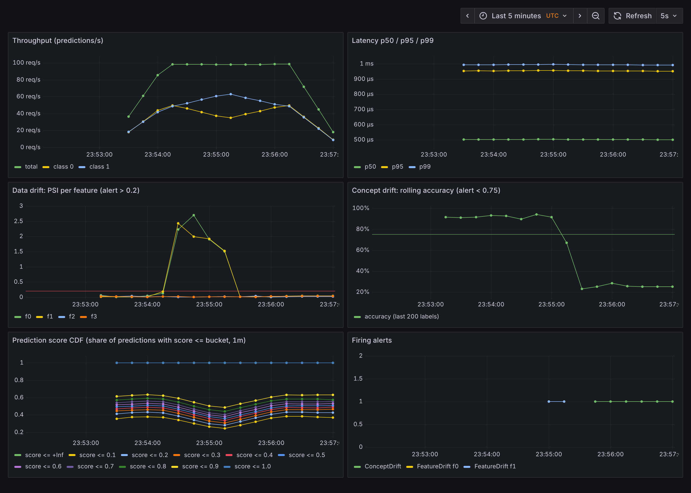

# ml-monitoring-stack

A served model with production monitoring, all from one `docker compose up`:
- **Prometheus metrics** (latency, throughput, prediction distribution);
- a **Grafana dashboard provisioned from JSON**;
- **data-drift** (PSI) and **concept-drift** (rolling accuracy from delayed labels) detection;
- **alert rules**;
- a **replay script** that streams normal, then shifted traffic so the alerts fire.



*The screenshot above is from a real run here. Normal traffic shows no alerts. Data drift (60 s) raises PSI on f0/f1 above 0.2, and **FeatureDrift** fires after its 30 s hold. Concept drift leaves the inputs looking normal (PSI drops back), but rolling accuracy falls from ~92 % to ~25 %, and **ConceptDrift** fires.*

## Setup
```bash
cd ml/ml-monitoring-stack
python3.12 -m venv .venv && . .venv/bin/activate
pip install -r requirements.txt
```

## Usage
```bash
python -m pytest -q                      # 5 tests, ~15 s, no Docker needed
docker compose up -d --build             # model :8000, Prometheus :9090, Grafana :3000 (anonymous viewer)
python replay.py                         # 3 phases × 6000 events at 100 rps (~3 min)
open http://localhost:3000               # "Model monitoring" dashboard is the home page
open http://localhost:9090/alerts        # FeatureDrift / ConceptDrift
python e2e_check.py                      # automated: replay + assert the right alert fires in the right phase
docker compose down
```

## Architecture
```
replay.py ──POST /predict──► model service (FastAPI, sklearn LogisticRegression)
          ──POST /feedback─►   ├─ DriftMonitor: last 500 inputs vs training deciles → PSI per feature (every 50 req)
             (true label)      ├─ RollingAccuracy: last 200 labelled predictions
                               └─ GET /metrics (prometheus_client)
                                        │ scrape every 5 s
                               Prometheus ── alerts.yml: FeatureDrift (PSI > 0.2, 30 s)
                                        │               ConceptDrift (accuracy < 0.75, 30 s)
                                        │               HighP95Latency (p95 > 100 ms, 1 m)
                               Grafana (datasource + dashboard provisioned from files)
```
| metric | type | meaning |
|---|---|---|
| `model_request_latency_seconds` | histogram | /predict serving time |
| `model_predictions_total{label}` | counter | throughput, split by predicted class |
| `model_score` | histogram | predicted probability distribution |
| `model_feature_psi{feature}` | gauge | data drift of recent inputs vs training data |
| `model_rolling_accuracy` | gauge | concept drift, from delayed ground truth |
| `model_feedback_total` | counter | labels received |

PSI is only reported once the 500-request window is full. On smaller windows PSI's small-sample bias (about 9/n with 10 bins) produced false alarms on clean traffic, a self-review finding. The gauge holds its last value if traffic stops.

Why both drift signals: the replay's third phase changes P(y | x) but not P(x). PSI stays at about 0, so a monitor that watches only input distributions misses it; only labelled feedback catches it. The second phase is the opposite case: inputs shift while the model is still mostly right. In this run accuracy stayed above 0.75 during the data-drift phase.

Tests (no Docker):
- the drift math;
- API validation and metrics exposure;
- the replay against the in-process app (PSI > 0.2 only in the data-drift phase; accuracy < 0.75 in the concept phase);
- config lint: every alert rule and dashboard query references a metric the service exports, compose has the 3 services, Prometheus scrapes `model:8000`.

The live stack check (`e2e_check.py`) runs in CI as a second job and was run here (see Results).

Data: seeded synthetic stream (4 features, logistic label); see `service/data.py`.

## Results (run here: Docker 29, Prometheus v3.5.0, Grafana 12.1.0, 4 vCPUs)
- `docker compose up` brings all 3 services healthy in about 10 s.
- `e2e_check.py`: `fired: [('concept-drift', 'ConceptDrift'), ('concept-drift', 'FeatureDrift'), ('data-drift', 'FeatureDrift')]` → **OK**. The check requires FeatureDrift in the data-drift phase, ConceptDrift in the concept phase, nothing in the normal phase, and no ConceptDrift during data drift.
  - Nothing fires during normal traffic.
  - FeatureDrift is still firing for a few seconds into the concept phase: the 500-event window and the scrape interval need time to clear.
- Serving latency in the container is p50 ≈ 0.5 ms. The p95/p99 shown (~1 ms) are interpolated inside the 0.5-1 ms histogram bucket, so they are an upper-bound estimate, not a measurement.
- Rolling accuracy: ~92 % on normal and shifted inputs, ~25 % after the concept flip.

**Debugging note.** In the first live run FeatureDrift never fired. The replay phases were 15 s long, shorter than the rule's 30 s `for:` hold. The rule was right and the demo was too short, so phases now last 60 s.

## Not done (time box)
Alertmanager with receivers (alerts fire in Prometheus; routing is deployment-specific), recording rules, long-term storage, auth on Grafana/Prometheus, label-delay simulation (labels arrive instantly in the replay).
